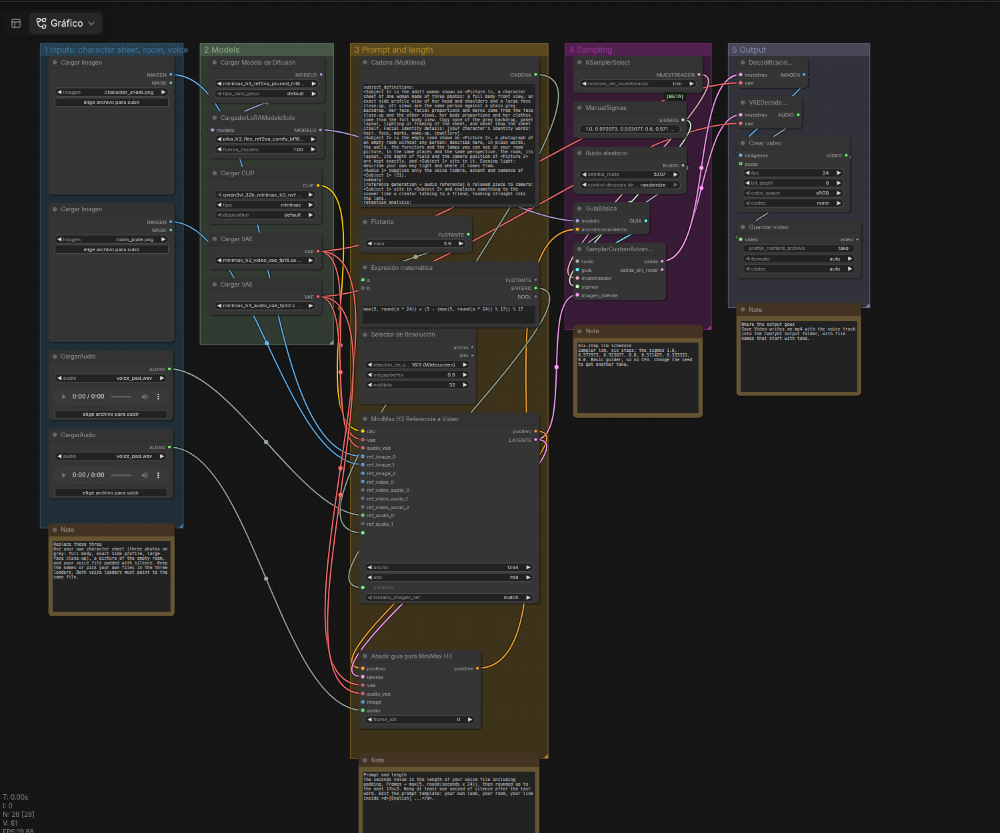

# How her weekly takes are made (local, no cloud)

Drag `minimax-h3-pika-flex.json` into ComfyUI: the same 24 nodes laid out left to right in labelled groups (inputs, models, prompt, sampling, output) with four short notes. `minimax-h3-pika-flex-api.json` is the same graph in ComfyUI's API format, for scripts. Both are text files only: no model weights and no frames from the model are in this repository.

The loaders will show your own file lists: pick the files named below, and your three inputs. ComfyUI marks a loader red until the picture or voice file exists in its `input` folder.

## What is in the graph
- **Model:** MiniMax H3 reference-to-video, int8 build, with the **Pika H3 Flex** adapter (a LoRA at strength 1.0). Pika H3 Flex adapter by Pika, a Model Derivative of MiniMax H3, used under the MiniMax H3 Community License Agreement. Get the files from their publishers; see `NOTICE.md`.
- **Sampler:** `lcm` with six hand-set sigmas (`1.0, 0.972973, 0.923077, 0.8, 0.571429, 0.333333, 0.0`), a basic guider (no CFG), 24 fps, 1344x768, seed 5207.
- **Three inputs you replace:** a character sheet (`character_sheet.png`, three photos on grey: full body, exact side profile, large face close-up), a picture of the empty room (`room_plate.png`) and a voice file padded with silence (`voice_pad.wav`). The graph asks for 17n+5 frames and keeps at least one second of silence after the last word.
- **The prompt** (node 138) names the sheet as `<Picture 1>`, the room as `<Picture 2>` and the voice as `<Audio 1>`, and says the line in `<d>[English] ...</d>`. We replaced our room and our line with slots.

## Models you need
Every file the graph names, with its official page. Sizes are the byte counts the Hugging Face API reports for the files, in decimal GB. We checked the pages on 2026-11-03.

| In the graph | File | Official page | Size | Licence |
|---|---|---|---|---|
| Load Diffusion Model | `minimax_h3_ref2va_pruned_int8_convrot.safetensors` into `models/diffusion_models/` | [Comfy-Org/MiniMax-H3](https://huggingface.co/Comfy-Org/MiniMax-H3/blob/main/diffusion_models/minimax_h3_ref2va_pruned_int8_convrot.safetensors), the ComfyUI build of the model from [MiniMaxAI/MiniMax-H3](https://huggingface.co/MiniMaxAI/MiniMax-H3) | 21.0 GB | [MiniMax H3 Community License Agreement](https://huggingface.co/MiniMaxAI/MiniMax-H3/blob/main/LICENSE) |
| Load LoRA | `pika_h3_flex_ref2va_comfy_bf16.safetensors` into `models/loras/` | [Pika-Labs/Pika-H3-Flex](https://huggingface.co/Pika-Labs/Pika-H3-Flex/blob/main/comfy/loras/pika_h3_flex_ref2va_comfy_bf16.safetensors), folder `comfy/loras/` | 1.96 GB | The Pika H3 Flex adapter is a Model Derivative of MiniMax H3, under the same MiniMax H3 Community License Agreement (see the repository's `NOTICE` and `THIRD_PARTY_NOTICES.md`) |
| Load CLIP (type `minimax`) | `qwen3vl_32b_minimax_h3_nvfp4_awq.safetensors` into `models/text_encoders/` | [Comfy-Org/MiniMax-H3](https://huggingface.co/Comfy-Org/MiniMax-H3/blob/main/text_encoders/qwen3vl_32b_minimax_h3_nvfp4_awq.safetensors) | 15.7 GB | Qwen3-VL-32B encoder, Apache License 2.0 (as Pika's third-party notice and the MiniMax agreement state). The 4-bit quant is converted from a third-party quant named on the Comfy-Org page. We did not check that quant's own page. |
| Load VAE (video) | `minimax_h3_video_vae_fp16.safetensors` into `models/vae/` | [Comfy-Org/MiniMax-H3](https://huggingface.co/Comfy-Org/MiniMax-H3/blob/main/vae/minimax_h3_video_vae_fp16.safetensors) | 5.2 GB | MiniMax H3 Community License Agreement (licence set on the repository page) |
| Load VAE (audio) | `minimax_h3_audio_vae_fp32.safetensors` into `models/vae/` | [Comfy-Org/MiniMax-H3](https://huggingface.co/Comfy-Org/MiniMax-H3/blob/main/vae/minimax_h3_audio_vae_fp32.safetensors) | 0.6 GB | MiniMax H3 Community License Agreement (same) |

About 44 GB in total. The Pika repository also holds the original adapters in another format; use the `comfy/loras/` file, because the ComfyUI graph needs that layout. The Pika page says the Comfy-format files were checked tensor by tensor but not yet in an end-to-end ComfyUI render at upload time; ours ran in ComfyUI 0.42.1.

**Read the licence before you download.** The MiniMax H3 Community License Agreement is limited to an "Applicable Territory": worldwide except the European Union, the United Kingdom, the Republic of Korea and the United States. For those territories MiniMax says to ask it for a licence. The documentation of Comfy says that commercial use of locally generated output needs a commercial licence from MiniMax through Comfy ([comfy.org/minimax/license](https://comfy.org/minimax/license)). This repository gives no legal advice; the licence text decides. If you share the files, you must pass on the licence and mark modified files.

### ComfyUI version and nodes
- **No custom node pack.** Every node in the graph is part of ComfyUI itself: `MiniMaxH3ReferenceToVideo` and `MiniMaxH3AddGuide` (file `comfy_extras/nodes_minimax_h3.py`), `ResolutionSelector`, `ComfyMathExpression`, `PrimitiveFloat`, `PrimitiveStringMultiline`, `ManualSigmas`, `CreateVideo` and `SaveVideo`, plus the usual loaders and samplers. In the Comfy docs the Reference-to-Video template needs ComfyUI **0.30.0 or newer** and chained guide nodes need **0.34.0 or newer**.
- We ran it on ComfyUI **0.42.1**. The first release with `ResolutionSelector` and `ComfyMathExpression`, and whether the `int8_convrot` files need a minimum version, we could not verify: use a current release.
- `ResolutionSelector` is in the graph but its outputs feed nothing; the picture size is the 1344x768 typed into the reference node.
- The Comfy docs say Comfy Kitchen attention cannot run `int8_convrot` checkpoints; leave the attention backend on the default.

## Three cameras
| camera | how we make it | face height, share of the frame |
|---|---|---|
| wide | the room picture at 1.0x | 23.8 % (band we accept: 23-29 %) |
| close | 1.9x **digital punch-in of the wide take**, then SeedVR2 7B blended 50 % with a plain Lanczos resize | 45.4 % on a 11.5 s line (band 44-54 %) |
| open side | the side room picture at 1.0x, she never looks into this lens | 20.6 % and 22.7 % on two lines (band 19-26 %) |

Why the close camera is not generated: asking the model for a 1.9x close made it draw the room about 20 % larger than the picture (room scale 1.195, we accept up to 1.07), even though her face came out at 49.2 %. Punching in the wide take keeps the room exactly the same size (scale 1.0 by construction).

## The short-outfit-text lesson
On a close-up the same sheet picture, seed and room gave a face of 32.9 % of the frame with our long outfit description and 46.5 % when we cut it by 6.3 % to the garment nouns only. We read that as the long outfit text being the cause, not the sheet picture. One seed, one line each, so it is a lead, not a law. We did not find out which clause in the text did it.

## Numbers we measured (one seed, one run per cell)
- Raw take of about 6 s: 225-241 s in ComfyUI on one consumer GPU (247 s with a restart); about 4.2 GPU-minutes.
- SeedVR2 finish for the close camera: about 10 GPU-minutes for a 5.9 s line.
- The simple finish (resize, light softening and grain) takes about 9-10 s of wall time per 6 s take on the CPU.
- Our checks on every take: one face in every 12th frame, face match above 0.55 on average, mouth-movement correlation above 0.25, no one-frame head jump, room scale 0.93-1.07. The open side camera at 1.0x failed the room-scale check on one line (1.107) and passed on the other (1.006).

Not measured: other seeds, other faces, other rooms.
